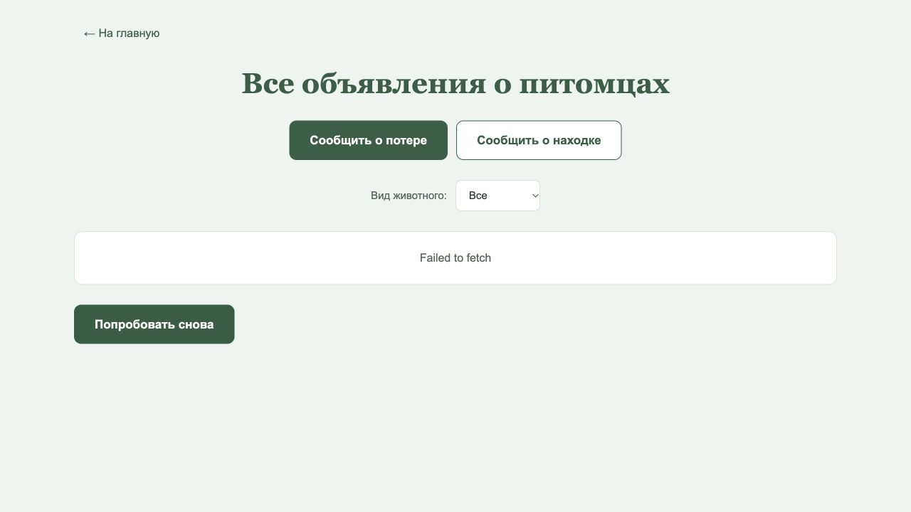

# QA-отчёт: «Питомец рядом»

Дата прогона: **26 ноября 2026**. Дедлайн 25 ноября прошёл; результаты не датировались задним числом.

Проверены чтение и фильтры общего API, доступ без входа и готовые части локального React. Создание, смена статуса, удаление, настоящая пользовательская авторизация и доставка уведомлений пока не подтверждены.

## Где проверялось

| Часть | Адрес / версия |
|---|---|
| Общий API | https://fur-project-s56k.onrender.com; SHA деплоя не предоставлен. OpenAPI FastAPI 0.1.0, с species/report_type, comment/contact_email. 0.1.0 не подтверждает версию commit |
| Новый выданный вход | https://async-fastapi-pet-core.onrender.com/login — 404 Not Found, x-render-routing: no-server |
| Репозиторий | main 8926b42; backend-ветка c299d3254ce5ac938517dbb0ed024a29f33a6437 просмотрена отдельно, соответствие серверу не установлено |
| React | PR №9, feature/react-start, 66b3638d05c03c00f8d2600cc357fa73bbe91bb6; http://127.0.0.1:5174, VITE_API_URL указывает на общий API |
| Сетевая ошибка | Отдельный Vite на 5175, VITE_API_URL=http://127.0.0.1:1; намеренно недоступный адрес, не отказ общего сервера |
| Окружение | macOS, встроенный браузер Codex (версия движка не зафиксирована), curl; Node.js 24.22.2, npm 11.19.1. Ширина 320 px эмулировалась |

Проверки выполнены инструментами HTTP и браузера. Физический телефон не использовался. Сценарии и данные: [qa-test-cases.md](qa-test-cases.md), [qa-test-data.csv](qa-test-data.csv).

## Результаты

| Что проверено | Факт |
|---|---|
| Список / одна запись | 200; объект ID 12 полностью совпал с объектом списка |
| Нет записи / неверный ID | /1000000 → 404 «Питомец не найден»; /abc → 422 int_parsing |
| Фильтры | cat → 12,11; dog → []; lost → 10,9,8,7; found → 12,11; cat+found → 12,11; несуществующий вид → [] |
| Админка и Swagger | Без cookie, Accept JSON: /admin и /docs → 401. При Accept text/html /admin перенаправляет на /login |
| Схема API | /openapi.json без cookie → 200, BUG-01 |
| React + API | Реальные карточки, загрузка, пустая выдача, выбор после обновления, открытие ID 12 и возврат с фильтрами работают |
| Главная | «Потерял» → found-каталог, «Нашёл» → lost-каталог, «Все объявления» → общий каталог. Это текущая логика встречного поиска; ожидание подтвердить с лидом |
| UI 404 | «Объявление не найдено или удалено», есть возврат в каталог |
| Ширина 320 | Каталог с карточками и форма: scrollWidth=innerWidth=320; прочие страницы и физическое устройство не проверены |
| Валидация UI | Пустые поля, описание из пробелов и телефон abc отклонены. Корректное заполнение даёт честное сообщение о неподключённой публикации, ввод сохранён |
| Подготовленная регистрация | Пустые поля и разные пароли отклонены; совпадающие данные не показывают ложную регистрацию. Настоящего запроса регистрации нет |
| Сборка / lint | build прошёл, lint завершился кодом 1, BUG-03 |

В базе при чтении было 6 записей: 12,11,10,9,8,7. Фильтры проверялись по составу относительно списка, а не только по HTTP 200. Собак в списке нет: непустую выборку dog и все четыре сочетания вида/типа нужно проверить на своих данных. Чужие записи не менялись. Новые объявления не создавались, очистка не требовалась.

## Ошибки

### BUG-01. Схема API доступна без входа

- Окружение: общий API, без cookie, Accept application/json.
- Шаг: `curl -i -H 'Accept: application/json' https://fur-project-s56k.onrender.com/openapi.json`.
- Ожидание: 401 — в backend/main.py есть обработчик схемы с verify_admin_token. Требуется подтвердить политику доступа к схеме текущего стенда.
- Факт: HTTP 200, JSON с info.title=FastAPI, info.version=0.1.0, paths и components.schemas; /docs при этом возвращает 401. Повторный GET дал тот же результат.
- Влияние: закрытая страница Swagger не ограничивает чтение схемы API. Доступ к чужим данным или административным действиям этим не подтверждён.
- Серьёзность: предварительно низкая, уточнить требование. Статус: открыто.

### BUG-02. Непонятный текст сетевой ошибки

- Окружение: локальный React PR №9, commit 66b3638.
- Шаги: в frontend выполнить `VITE_API_URL=http://127.0.0.1:1 npm run dev -- --host 127.0.0.1 --port 5175`; открыть `http://127.0.0.1:5175/#/pets`; после ошибки нажать «Попробовать снова».
- Ожидание: объяснение на русском, что объявления не загрузились, и возможность повторить.
- Факт и подтверждение: в каталоге видны `Failed to fetch` и кнопка «Попробовать снова». После нажатия при недоступном API ошибка остаётся. Восстановление после появления сети не проверено.
- Влияние: пользователь не понимает причину и дальнейшее действие. Серьёзность: низкая. Статус: открыто.

### BUG-03. Общий ESLint не проходит

- Окружение: frontend PR №9, commit 66b3638, Node 24.22.2 / npm 11.19.1.
- Шаги: из frontend выполнить `npm ci`, затем `npm run lint`.
- Ожидание: exit code 0.
- Факт: exit code 1; `src/api/pets.ts:14:11`, `error Empty block statement no-empty`. Пустой catch расположен в apiError.
- Подтверждение вывода: `✖ 1 problem (1 error, 0 warnings)`. В том же окружении npm run build прошёл.
- Влияние: проверка качества ветки красная; если lint обязателен, это мешает приёмке. Серьёзность: низкая. Статус: открыто. Код приложения не исправлялся в рамках QA.

## Блокировки

### BLOCK-01. Новый адрес входа недоступен

https://async-fastapi-pet-core.onrender.com/login возвращает HTTP 404, Content-Type text/plain, тело `Not Found`, `x-render-routing: no-server`. Подтверждено браузером и curl. Поля входа нет; данные аккаунта не отправлялись. Это не подтверждение неправильного пароля.

Нужны рабочая ссылка, подтверждение назначения тестового аккаунта и версия деплоя. Данные входа не переносились на другой домен без подтверждения.

До этого заблокированы создание и очистка своих записей, смена статуса, удаление, административный вход/выход и валидация POST. POST не выполнялся, чтобы не оставить записи без проверенной возможности удалить их.

### Интеграции: не готово к проверке целиком

- Пользовательская регистрация/вход и публикация через React: в PR №9 подготовлены формы, отправка не подключена. Административный вход не заменяет пользовательскую авторизацию.
- Контакт и координаты: UI принимает телефон/Telegram и точку; серверная схема — contact_email, без координат. Максимум описания: UI 2000, API 340. Это блокировка интеграции; опубликованные данные не проверялись.
- Backend README: инструкция почти прежняя, backend/requirements.txt пуст. Воспроизводимый запуск с PostgreSQL и тестовыми переменными не передан. Полный backend локально не запускался.
- Уведомления: PR №10 cc6963b6 содержит отдельную интеграцию и отчёт автора. В проверенной ветке PR №9 подписка не подключена; версия сервера, VAPID и доступ к тестовой отправке не подтверждены. Разрешение/отказ, доставка, клик и отписка в этом QA-прогоне не выполнялись.
- Модерация: PR №11 2234d4d — отдельный модуль без подключения к публикации. QA-016–020 подготовлены, но не пройдены. Ключа нет; платные запросы к ИИ не выполнялись.

Результаты авторов PR №10 и №11 не выдаются за собственную повторную проверку.

## Данные и запуск

20 примеров остаются в одном CSV. Сопоставление с текущими полями и отдельные контакты для UI описаны в тест-кейсах. Email не заменён на телефон/Telegram до согласования нового серверного контракта. Неизвестные правила отмечены вопросами.

React установлен и запущен. В инструкции указан путь другого участника `/home/liza/...`; на macOS использована своя папка frontend. Первая попытка npm ci упёрлась в права пользовательского кэша; `npm ci --cache ../npm-cache` прошёл. Это особенность окружения, не доказанный дефект приложения. Node.js 24.22.2 удовлетворяет указанному требованию 22.12+.

## Следующие действия

1. Получить рабочий вход и SHA деплоя; выполнить W01–W05 и V01–V08, удалить свои объявления.
2. Согласовать контакт, длину описания, координаты и пользовательскую авторизацию; проверить подключённые функции прямыми запросами и через UI.
3. Получить стенд уведомлений и выполнить N08. Модерацию проверить после передачи согласованного запуска.
4. После исправлений повторить BUG-01–03. Пока исправления не передали, повторная приёмка не выполнена.

Сводка для команды: чтение, доступные фильтры и связка локального каталога с API проверены; есть три замечания. Оставшиеся проверки блокируют нерабочая новая ссылка входа и незавершённые интеграции. Данные доступа и реальные контакты из объявлений в материалы не включены.
