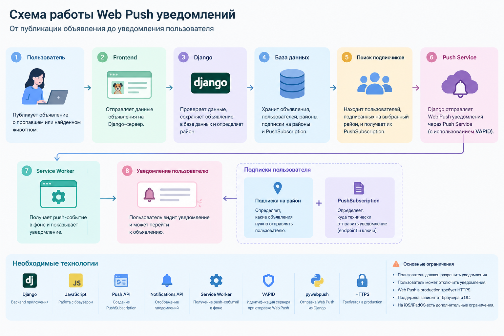

# Web Push уведомления

## Цель

Организовать отправку уведомлений пользователям о новых объявлениях
о пропавших и найденных животных в выбранных ими районах.

## Схема работы

1. Пользователь публикует объявление о пропавшем или найденном животном.
2. Frontend отправляет данные объявления на Django-сервер.
3. Django проверяет данные и сохраняет объявление в базе данных.
4. Система определяет район, указанный в объявлении.
5. Django находит пользователей, подписанных на этот район.
6. Для этих пользователей получаются Push-подписки.
7. Django отправляет Web Push уведомления.
8. Браузер получает push-событие через Service Worker.
9. Service Worker показывает пользователю уведомление.
10. Пользователь может перейти из уведомления к объявлению.

### Общая схема

Публикация объявления  
↓  
Django  
↓  
Сохранение в базе данных  
↓  
Определение района  
↓  
Поиск подписчиков района  
↓  
Получение PushSubscription  
↓  
Отправка Web Push  
↓  
Push Service браузера  
↓  
Service Worker  
↓  
Уведомление пользователя

## Необходимые технологии

### Django

Backend приложения. Обрабатывает объявления, работает с базой данных
и определяет пользователей, которым нужно отправить уведомление.

### JavaScript

Используется в браузере для регистрации Service Worker, запроса
разрешения на уведомления и создания push-подписки.

### Push API

Используется для создания PushSubscription, которая позволяет
браузеру получать push-уведомления.

### Notifications API

Используется для отображения уведомлений пользователю.

### Service Worker

Специальный JavaScript-файл, который может работать в фоне и
получать push-события даже когда страница сайта не открыта.

### VAPID

Используется для идентификации сервера при отправке Web Push
уведомлений.

### pywebpush

Python-библиотека, которую можно использовать в Django для отправки
Web Push уведомлений.

### HTTPS

В production для Service Worker и Web Push требуется защищённое
соединение HTTPS.

## Какие данные потребуется хранить

- пользователей;
- объявления;
- районы;
- подписки пользователей на районы;
- PushSubscription пользователей.

PushSubscription содержит endpoint и криптографические ключи,
необходимые для отправки уведомления конкретному браузеру.

## Логика подписок

Подписка на район и PushSubscription - это разные вещи.

Подписка на район отвечает на вопрос:

> Какие объявления нужно отправлять пользователю?

Например, пользователь подписан на район Хамовники.

PushSubscription отвечает на вопрос:

> Куда технически отправить уведомление?

Таким образом, при создании объявления система сначала определяет
район, затем находит пользователей, подписанных на этот район, и
получает их PushSubscription.

## Ограничения

- Пользователь должен самостоятельно разрешить уведомления.
- Пользователь может запретить или отключить уведомления.
- Web Push в production требует HTTPS.
- Поддержка Web Push зависит от браузера и операционной системы.
- На мобильных устройствах могут существовать дополнительные
  ограничения.

## Текущий статус

На данном этапе исследована архитектура Web Push уведомлений и
подготовлена схема их работы.

К существующим страницам Django система уведомлений пока не подключена.

## Что требует дальнейшей реализации

- модель подписок пользователей на районы;
- хранение PushSubscription в базе данных;
- регистрацию Service Worker;
- запрос разрешения на уведомления;
- создание PushSubscription на frontend;
- передачу PushSubscription на Django;
- настройку VAPID;
- отправку Web Push из Django;
- выбор получателей по району;
- переход из уведомления к соответствующему объявлению.
